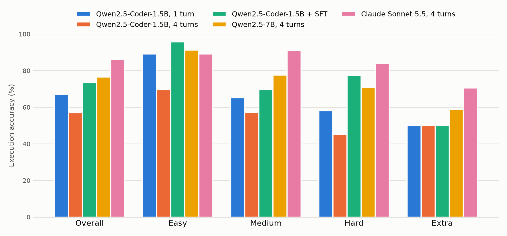
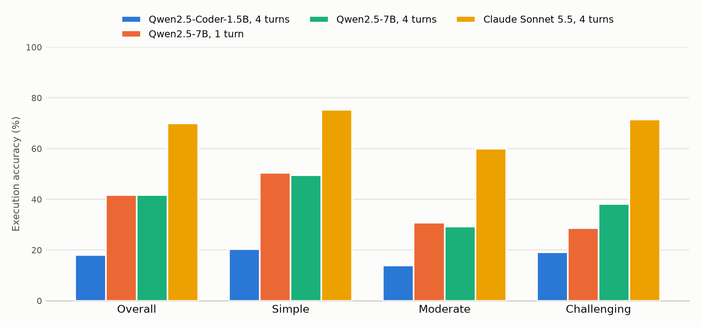

# SQL Agent RL

 

**A text-to-SQL agent that runs its own queries, reads the errors and fixes them — and a small open model trained with reinforcement learning to do it well.**

The agent answers business questions over a SQLite database in a loop: write SQL, execute it in a sandbox, read the result or the error, correct, answer. A small open model (Qwen2.5-Coder, 1.5B–7B) is fine-tuned with SFT, then with **GRPO on a verifiable reward**: does the query return the right result?

Every claim below is measured, with confidence intervals, and reproducible from this repository.

## Results

All models are scored on the same 200 random dev questions per benchmark (`--seed 0`). API models run through OpenRouter; Qwen2.5-Coder-1.5B runs on a Colab GPU with vLLM, on the full dev sets, and is shown here on the same 200 questions (full-dev numbers below the tables). Raw episodes and summaries are committed in [`results/`](results).

### Spider

<picture>
  <source media="(prefers-color-scheme: dark)" srcset="docs/results-dark.png">
  
</picture>

| Model | Max turns | Execution accuracy (95% CI) | First attempt | Easy | Medium | Hard | Extra | Cost |
|---|---|---|---|---|---|---|---|---|
| Qwen2.5-Coder-1.5B, 1 turn | 1 | **67.0%** (60.0%–73.0%) | 67.0% | 89% | 65% | 58% | 50% | $0 (Colab) |
| Qwen2.5-Coder-1.5B, 4 turns | 4 | **57.0%** (50.0%–63.5%) | 67.0% | 70% | 57% | 45% | 50% | $0 (Colab) |
| Qwen2.5-Coder-1.5B, 4 turns, majority of 5 | 4 | **70.0%** (63.5%–76.0%) | 57.0% | 80% | 72% | 61% | 59% | $0 (Colab) |
| Qwen2.5-Coder-1.5B + SFT | 4 | **73.5%** (67.0%–79.5%) | 73.0% | 96% | 70% | 77% | 50% | $0 (Colab) |
| Qwen2.5-Coder-1.5B + SFT + GRPO | 4 | *in progress* | | | | | | $0 (Colab) |
| Qwen2.5-7B, 1 turn | 1 | **72.5%** (66.5%–78.5%) | 72.5% | 93% | 75% | 58% | 50% | $0.02 |
| Qwen2.5-7B, 4 turns | 4 | **76.5%** (70.5%–82.5%) | 72.0% | 91% | 78% | 71% | 59% | $0.04 |
| Claude Sonnet 5.5, 4 turns | 4 | **86.0%** (81.0%–90.5%) | 85.0% | 89% | 91% | 84% | 71% | $0.86 |

On the full Spider dev set (1,034 questions), Qwen2.5-Coder-1.5B scores 61.4% with 1 turn, 51.8% with 4 turns, 61.3% with a majority of 5, and **73.5% after SFT** ([`results/spider-dev/`](results/spider-dev)).

### BIRD

Larger, messier real-world databases, never seen in training; each question comes with an evidence hint. Scored with BIRD's official rule (sets of rows). One question is excluded because its gold query runs over 30 s.

<picture>
  <source media="(prefers-color-scheme: dark)" srcset="docs/results-bird-dark.png">
  
</picture>

| Model | Max turns | Execution accuracy (95% CI) | First attempt | Simple | Moderate | Challenging | Cost |
|---|---|---|---|---|---|---|---|
| Qwen2.5-Coder-1.5B, 4 turns | 4 | **18.1%** (13.1%–23.6%) | 20.1% | 20% | 14% | 19% | $0 (Colab) |
| Qwen2.5-Coder-1.5B + SFT + GRPO | 4 | *in progress* | | | | | $0 (Colab) |
| Qwen2.5-7B, 1 turn | 1 | **41.7%** (34.7%–48.7%) | 41.7% | 50% | 31% | 29% | $0.04 |
| Qwen2.5-7B, 4 turns | 4 | **41.7%** (35.2%–48.2%) | 38.7% | 50% | 29% | 38% | $0.11 |
| Claude Sonnet 5.5, 4 turns | 4 | **69.8%** (63.8%–76.4%) | 61.3% | 75% | 60% | 71% | $2.21 |

On the full BIRD dev set (1,532 questions), Qwen2.5-Coder-1.5B with 4 turns scores 24.8% ([`results/bird-dev/`](results/bird-dev)).

### What the numbers say

- **SFT on free data takes the 1.5B model to the level of a model five times its size.** On the full Spider dev set it goes from 61.4% (its best untrained setting, 1 turn) to 73.5%: **+12.1 points** (paired bootstrap: 95% CI +9.3 to +15.0). On the 200 shared questions it is within noise of Qwen2.5-7B with 4 turns (−3.0 points, CI −10.0 to +4.0), at a fifth of the parameters and no API cost.
- **The untrained 1.5B model is hurt by the self-correction loop: −9.6 points** (CI −12.1 to −7.0) when allowed 4 turns instead of 1. It almost never stops early (1,028 of 1,034 episodes use all 4 turns): 141 correct first drafts are explored away into wrong answers, against 38 wrong drafts fixed, and 133 episodes end without an answer. Sampling 5 episodes and voting on the result recovers the loss (+9.5 points), so the right answer is often within reach; the model just does not know when to stop.
- **SFT teaches it to answer, not yet to correct itself.** After SFT, 958 of 1,034 episodes end on the first turn and no correct first draft is lost, but of the 76 episodes that hit a SQL error only 4 recover. Learning to use the feedback is the job left to GRPO.
- **On Spider, the self-correction loop pays off: +4.0 points** for Qwen2.5-7B (paired bootstrap: 95% CI +0.0 to +8.0, P(no gain) = 0.04), concentrated on hard questions (58% → 71%).
- **On BIRD, the same 7B model gets nothing from the loop: +0.0 points** (95% CI −4.5 to +4.5). It hits a SQL error in 54 of 199 episodes and recovers in only 13; 19 episodes never produce an executable answer, and 5 correct first drafts get "fixed" into wrong ones. Claude, given the same loop, goes from 61.3% on its first attempt to 69.8%, mostly by exploring the data before answering. **Using feedback well is a skill the small model lacks — exactly what RL on an execution reward should teach.**
- **The gap to a frontier model triples on BIRD**: 9.5 points on Spider (CI +3.0 to +16.0), 28.1 on BIRD (CI +21.1 to +35.7). Spider is close to saturation; BIRD is where training has room to show.
- **Spider's ceiling is partly a benchmark artifact.** 5 of Claude's 13 easy/medium failures are correct queries scored as wrong. In the `flight_2` database, airport codes are stored with a leading space: the gold query `DestAirport = "APG"` returns 0 rows, while the model's `TRIM(DestAirport) = 'APG'` returns the actual flights.

## Example episode

A real episode from Qwen2.5-7B (dev-530). The first draft fails, the model reads the SQLite error, fixes it, and gets it right on the third turn.

```text
Q: For each semester, what is the name and id of the one with the most students registered?

model › <sql>SELECT semester_id, semester_name FROM (SELECT semester_id, COUNT(*) AS student_count,
        ROW_NUMBER() OVER (ORDER BY COUNT(*) DESC) AS rank FROM Student_Enrolment GROUP BY semester_id) sub
        WHERE rank = 1</sql>
        ERROR: no such column: semester_name

model › <answer>SELECT semester_id, semester_name FROM Semesters JOIN (…) sub
        ON Semesters.semester_id = sub.semester_id WHERE sub.rank = 1</answer>
        Your answer failed: ERROR: ambiguous column name: semester_id

model › <answer>SELECT s.semester_id, s.semester_name FROM Semesters s JOIN (…) sub
        ON s.semester_id = sub.semester_id WHERE sub.rank = 1</answer>
        ✔ correct
```

Replay any question live with `python -m sql_agent demo --id dev-530 --model <model> --max-cost 0.05`.

## How it works

```text
question + schema + sample rows ─▶ model ─▶ <sql>…</sql> or <answer>…</answer>
                                     ▲                    │
                                     │                    ▼
                                     └─ <result> rows or error </result> ◀── SQLite sandbox
                                              (up to N turns)
reward = does the final answer return the same result as the gold query?
```

- **Text protocol, not tool calling.** `<sql>` explores, `<answer>` concludes. A 1.5B model learns it in a few hundred examples, and the very same conversations serve as evaluation traces, SFT data and GRPO prompts. Only the first tag of a reply is read, so a model that hallucinates its own query result cannot pollute the history.
- **The final answer is executed too.** If it fails, the model sees the error and can retry. It can answer in one turn when confident (fast, cheap) and still fall back on the loop.
- **Schema with sample rows.** `CREATE TABLE` statements plus 3 rows per table, which show the actual value formats (`'F'` vs `'female'`, dates, casing), where many text-to-SQL errors happen. `--sample-rows 0` removes them for ablations.
- **Sandbox.** Read-only database, one statement per call, `ATTACH` denied, bounded execution time and row count. Errors are never raised: they are returned to the model, because that is the signal it learns from.
- **Reward.** Each benchmark's official rule. Spider: row order only matters when the gold query has an `ORDER BY`, column order and names never matter, `3 == 3.0`. BIRD: results compared as sets of rows. Binary and checked against the database: no partial credit for "it runs", which would teach the model to answer `SELECT 1`. Validated on all 11,837 runnable Spider gold queries and all 1,532 BIRD dev gold queries that finish within 30 s (`check-gold`).

## Training

**SFT data, built for free** from Spider's train gold queries (`build-sft`), without any API call:

- 8,656 **direct answers**;
- 2,605 **corrections**: the gold query is broken (misnamed column or table), the sandbox returns the *real* SQLite error, and the target is the correct query. The broken query only appears in the prompt and is never a training target.

Conversations are split turn by turn into prompt / completion pairs, so the loss only covers the expected reply. `build-sft --from-run` also turns the successful episodes of a strong model into SFT data (distillation).

**GRPO** ([TRL](https://github.com/huggingface/trl) `GRPOTrainer`, LoRA, vLLM colocated) with three deliberate choices:

1. **Prompt filtering.** GRPO compares replies within a group: a question the model always solves (or always fails) yields zero advantage and wasted compute. [`filter_prompts.py`](train/filter_prompts.py) samples 8 replies per prompt from the SFT model and keeps only prompts with a success rate strictly between 0 and 1.
2. **Turn-level episodes.** Each prompt is either a fresh question or a state where the previous answer failed with a real error, so the model learns both to answer right and to recover.
3. **Reward** = binary execution correctness + a 0.1 format bonus.

## Evaluation methodology

- **95% bootstrap confidence intervals** on every score, and **paired comparisons** between runs (`compare`): on the same questions, pairing removes the variance due to the questions themselves. A gain whose interval contains 0 is not reported as a gain.
- **Spider difficulty levels** computed exactly like the official script (the dev split reproduces the official 248 / 446 / 174 / 166 breakdown).
- **Self-correction gain**: every episode keeps its first attempted query, compared with the final answer.
- **Majority voting** (`--samples k`): keep the query whose *result* comes up most often; `pass_at_k` gives the ceiling a better selector could reach.
- **The test split is run once**, at the end. Settings are chosen on dev.

## Reproduce

```bash
make setup data test          # virtualenv, Spider (~200 MB) and BIRD dev (~350 MB), 36 unit tests
make check-gold               # the reward accepts every Spider and BIRD dev gold query
make sft-data                 # 11,261 SFT rows, free
make report report-bird       # README tables + charts from results/
```

Training and free baselines run on Google Colab:

| Notebook | GPU | What it does |
|---|---|---|
| [`01_baseline_vllm`](notebooks/01_baseline_vllm.ipynb) | free T4 | base model served by vLLM, evaluated with 1 and 4 turns on Spider dev, then on BIRD dev |
| [`02_sft`](notebooks/02_sft.ipynb) | free T4 (slow) or A100 | SFT data, LoRA training, merge, evaluation |
| [`03_grpo`](notebooks/03_grpo.ipynb) | A100 (Colab Pro) | prompt filtering, GRPO, Spider dev and BIRD dev, then Spider test |

The same `sql_agent eval` talks to vLLM (`--base-url http://localhost:8000/v1`) or to OpenRouter, so every number is comparable. Paid runs are guarded: `estimate` predicts tokens and cost without any call, and `eval` refuses to call OpenRouter without a `--max-cost` cap, then stops at the cap.

```bash
cp .env.example .env          # then set OPENROUTER_API_KEY
python -m sql_agent estimate --split dev --limit 200 --price-in 0.1 --price-out 0.2
python -m sql_agent eval --model qwen/qwen-2.5-7b-instruct --split dev --limit 200 --max-cost 0.5
```

## Repository layout

```text
src/sql_agent/
  agent.py      agent loop, text protocol, feedback messages
  sandbox.py    read-only SQLite execution with time and row limits
  reward.py     execution-accuracy reward, result fingerprint for voting
  evaluate.py   parallel evaluation, majority vote, summaries
  stats.py      bootstrap CIs and paired comparison
  hardness.py   official Spider difficulty levels
  data.py       Spider and BIRD loaders, schema prompt with sample rows
  synth.py      free SFT data: direct answers and real-error corrections
  rl.py         GRPO reward functions (torch-free, unit-tested)
  report.py     results table and light/dark chart
train/          SFT, prompt filtering, GRPO, LoRA merge
notebooks/      Colab notebooks
results/        committed run summaries and raw episodes
docs/           charts, development workflow with Claude Code + MCP
tests/          36 tests, no dataset or API needed
```

How this project is worked on with Claude Code and MCP servers (W&B, Hugging Face, the benchmark
databases, agent traces) is described in [docs/dev-workflow.md](docs/dev-workflow.md). The agent's
evaluation episodes are also the sample dataset of the companion project
[agent-observatory](https://github.com/LacosteEvan/agent-observatory). That project traces
them, judges them with calibrated LLM judges and detects regressions between agent versions.

## Roadmap

- [x] Agent, sandbox, verifiable reward, evaluation with CIs
- [x] Free SFT data, prompt filtering, GRPO and SFT scripts, Colab notebooks
- [x] Baselines on Spider and BIRD: Qwen2.5-7B (1 and 4 turns) and a frontier ceiling
- [x] Qwen2.5-Coder-1.5B evaluated on Colab with vLLM, 1 and 4 turns, majority of 5, Spider and BIRD dev
- [x] SFT on Qwen2.5-Coder-1.5B: +12.1 points on Spider dev
- [ ] GRPO from the SFT model, tracked in Weights & Biases
- [ ] Final test-set evaluation, trained model published on the Hugging Face Hub
- [ ] Trained model evaluated on BIRD dev (out-of-domain generalization)
- [ ] Trajectory-level GRPO with multi-turn rollouts

## Limitations

- **GRPO is turn-level, not trajectory-level**: the reward scores the reply to a given state, not a full episode. Multi-turn rollouts (TRL's experimental `environment_factory`) are the natural next step.
- **Training uses Spider only.** BIRD serves as an out-of-domain test; its 9 GB train set would be the next lever.
- **Spider is close to saturation** for recent models and has label noise (see Results), hence the BIRD evaluation.
- **Synthetic corrections only cover naming errors.** Logic errors (wrong join, wrong filter) are only learned through distillation or GRPO.

## What didn't work

- **Ending the episode on `<answer>` without executing it.** In the first version, a final answer that crashed was final. Executing the answer and returning the error lets the model recover, at no cost when it is right.
- **DuckDB as the execution engine.** Spider's gold queries are written for SQLite; under DuckDB some return different results (case-sensitive `LIKE`, stricter typing), which would corrupt the reward. The sandbox uses SQLite.
- **A 100,000-row cap in the reward.** Two BIRD gold queries return more rows than that, so even the gold query scored as wrong against itself. `check-gold` caught it; the cap is now 1,000,000 rows and gold queries get a 30 s budget.
- **Qwen2.5-Coder-7B through OpenRouter.** It is not served there, so API baselines use Qwen2.5-7B-Instruct; the Coder models are evaluated on Colab with vLLM.

*To be extended during training.*

## License

MIT
