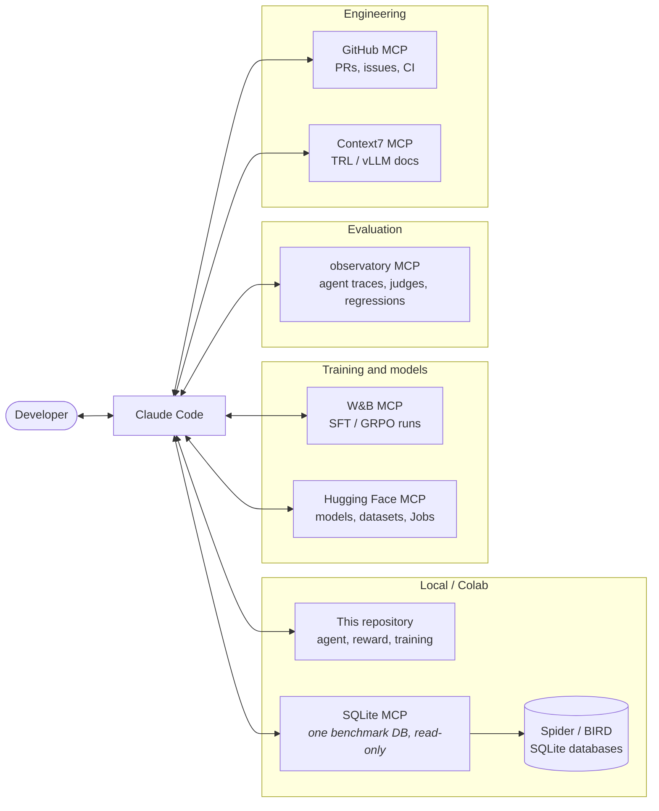

# Development workflow: Claude Code + MCP

Training a model is mostly a loop of reading failures, changing one thing, retraining and measuring.
This project is set up so that an AI coding agent (Claude Code) can take part in that loop through the
[Model Context Protocol](https://modelcontextprotocol.io). It can read the training runs, the
benchmark databases, the published models and the traces of evaluation runs.

The servers are declared in [`mcp.example.json`](mcp.example.json). Copy it to `.mcp.json` at the
repository root and Claude Code will offer to enable them when it opens the project. Credentials come
from environment variables. **None of them is needed to train, evaluate or reproduce the results.**

## Architecture

| Server | What it is for here | Access |
|---|---|---|
| **Weights & Biases** | Read SFT/GRPO curves (reward, KL, completion length), compare runs, spot reward hacking early | API key, read |
| **Hugging Face** | Find base models and datasets, push the fine-tuned checkpoints and their model cards, launch GPU Jobs | Token, write on the project's repos only |
| **SQLite** ([mcp-server-sqlite](https://github.com/modelcontextprotocol/servers-archived/tree/main/src/sqlite)) | Look at the real data behind a failed question: value formats, NULLs, join keys | One benchmark database, opened read-only |
| **observatory** ([agent-observatory](https://github.com/LacosteEvan/agent-observatory)) | Every evaluation episode as a trace: search failures, read trajectories, compare model versions with a calibrated judge | Read-only |
| **GitHub** | PRs with the updated results table, CI status, issues | Fine-grained PAT, repo-scoped |
| **Context7** | Current docs for fast-moving libraries (TRL's GRPOTrainer, vLLM, PEFT) | Public |

## Loops it enables

**1. Error analysis after an eval run.**
"Show me the BIRD questions the GRPO model gets wrong but the SFT model got right." Claude compares
the two runs through the observatory server and reads the flipped trajectories. It then opens the
question's database through SQLite MCP to check what the gold query relies on, such as a value
stored as `'F'` and not `'female'`. The output is a list of failure modes with counts, which decides
the next training change.

**2. Watching a GRPO run.**
"Is run `grpo-0412` learning or hacking the reward?" Claude reads the reward, KL and completion-length
curves through W&B. Rising reward with collapsing length is a typical hack. It pulls logged
completions to check, before more GPU hours are spent.

**3. Shipping a model.**
After the final test-set evaluation, Claude pushes the merged checkpoint to the Hugging Face Hub and
writes the model card from the results table. It then opens the PR that updates the README, through
GitHub.

## Guardrails

- **Credentials are never committed.** They come from `HF_TOKEN`, `WANDB_API_KEY` and `GITHUB_PAT`.
  Each token is scoped to this project.
- **Benchmark databases are opened read-only.** The agent's own sandbox does the same with
  `mode=ro`.
- **The test set stays sealed.** Error analysis uses the dev split. The test split is evaluated once
  per model, at the end, as the README states.
- **Every action outside the repository asks for confirmation in Claude Code.** That covers pushing
  a model, opening a PR and starting a paid GPU Job.
